# Plan de Implementación: Tarjetas 3D con Volteo Interactivo (Moxen) en el Panel de Supervisión

Este plan detalla la arquitectura, el diseño de información (frente vs. dorso) y la integración técnica de la animación física **Moxen Volteo** en las tarjetas de profesores de la **Cuenta Maestra (Coordinación Académica FIUAT)**.

---

## 1. Objetivos del Diseño

1. **Respeto total al Layout y Tamaño Existente:** Las tarjetas mantienen su ancho y altura dentro de la grilla responsive actual (`minmax(min(100%, 320px), 1fr)`), conservando la alineación y el flujo visual del panel de 154 docentes.
2. **Jerarquía de Información Estratégica:**
   - **Cara Frontal (Escanear):** Información general para supervisión rápida sin saturar la vista.
   - **Cara Posterior / Dorso (Actuar y Profundizar):** Acciones ejecutivas (Supervisar, Administrar clave), desglose de grupos, aulas, cálculo de carga horaria y días.
3. **Física Realista de Resorte (Moxen):** Mantener el rebote elástico, el brillo dinámico de canto y la sombra interactiva con aceleración GPU, adaptados a la paleta institucional (azul noche, naranja UAT, modo claro/oscuro).
4. **Cero Conflictos de Clics:** Los botones internos (Supervisar, Administrar, Enlaces) ejecutan su acción sin disparar el volteo accidental (`event.stopPropagation()`).

---

## 2. Propuesta de Distribución de Contenido

```mermaid
flowchart LR
    subgraph Frente["CARA FRONTAL (Resumen Rápido)"]
        F1["Avatar UAT/FI + Nombre del Docente"]
        F2["Academia / Departamento + Estatus (Activo)"]
        F3["3 Pastillas de Resumen:<br>• Total Materias<br>• Total Alumnos<br>• Carga Horaria Estimada"]
        F4["Vista previa de 2 materias principales con grupo y aula"]
        F5["Botón de giro: 'Ver detalles y acciones ↻'"]
    end

    subgraph Giro["Animación Física Moxen 3D"]
        direction TB
        G1["• Resorte elástico (Euler)"]
        G2["• Brillo satinado dinámico"]
        G3["• Canto con grosor 3D"]
        G4["• Sombra reactiva en suelo"]
    end

    subgraph Dorso["CARA POSTERIOR (Acciones y Desglose)"]
        D1["Header: Nombre compacto + Correo / Usuario"]
        D2["Desglose de Grupos, Aulas y Días:<br>• Lista con scroll de todas las materias<br>• Aula asignada (ej. DEI-AMBIENTAL, A-110)<br>• Horas por materia y días lectivos"]
        D3["Barra de avance de captura de calificaciones"]
        D4["Acciones Principales:<br>• Botón 'Supervisar / Auditar Calificaciones'<br>• Botón 'Administrar Cuenta / Clave'"]
        D5["Botón de retorno: 'Volver al frente ↺'"]
    end

    Frente -->|Clic en tarjeta o botón| Giro --> Dorso
    Dorso -->|Clic en botón de retorno o borde| Giro --> Frente
```

---

## 3. Detalle de Contenido por Cara

### A. Cara Frontal (Escanear en 2 segundos)
* **Encabezado:**
  * Avatar institucional circular con borde UAT.
  * Nombre completo del profesor (`font-weight: 700`, corte legible).
  * Departamento académico (`Facultad de Ingeniería Tampico`).
  * Badge de estado operativo (`Activo`).
* **Métricas Principales (KPIs en minitarjetas):**
  * **Materias Asignadas:** ej. `4 listas`.
  * **Alumnos Matriculados:** Suma real de alumnos en sus actas (ej. `98 alumnos`).
  * **Carga Semanal Estimada:** Calculada automáticamente a razón de 4 horas/semana por materia (ej. `16 hrs/sem`).
* **Avance:**
  * Indicador de estatus general de captura.
* **Pie de Tarjeta:**
  * Botón accesible con affordance clara: `Ver detalle y acciones ↻`.

### B. Cara Posterior (Profundizar y Operar)
* **Encabezado del Dorso:**
  * Nombre resumido del docente y correo electrónico institucional.
  * Tag de rol (`Docente Titular` o `Administrador`).
* **Desglose Académico y Horarios:**
  * Lista estilizada (con scroll suave si tiene más de 3 materias):
    * Nombre de la materia y grupo (`G.SA35.360 • Grupo A`).
    * **Aula:** Tag de aula registrada en el sistema (`A-110 P`, `DEI-AMBIENTAL P`, etc.).
    * **Días y Horario:** Muestra los días y carga semanal estimada (ej. `Lunes - Miércoles - Viernes • 4 hrs`).
    * **Alumnos por grupo:** Total de estudiantes inscritos.
* **Zona de Acciones Principales:**
  * **Botón Destacado:** `Supervisar / Auditar Calificaciones` (con icono de actas y gradiente naranja/azul UAT).
  * **Botón Secundario:** `Administrar Cuenta / Clave` (icono de candado para restablecimiento de acceso y credenciales).
* **Pie del Dorso:**
  * Enlace / botón de volteo de regreso: `↺ Volver al frente`.

---

## 4. Adaptación Técnica del Código Moxen

### Archivos involucrados:
1. [styles.css](file:///C:/Users/andre/Documents/Proyectos/Calificaciones%20Inge/styles.css):
   - Integración de los estilos de `.vo-tarjeta`, `.vo-giro`, `.vo-cara`, `.vo-canto`, `.vo-sombra`, `.vo-brillo`.
   - Modificación para que el contenedor `.admin-teacher-card` actúe como `.vo-tarjeta` preservando el tamaño y proporciones del panel (altura estandarizada de ~400px para evitar saltos de layout).
   - Variables de color vinculadas a los temas claro/oscuro del sistema (`var(--bg-primary)`, `var(--text-primary)`, `var(--uat-orange)`).
2. [app.js](file:///C:/Users/andre/Documents/Proyectos/Calificaciones%20Inge/app.js) (función `renderTeachers`):
   - Modificación del HTML generado para cada tarjeta docente para estructurar las dos caras (`.vo-frente` y `.vo-dorso`).
   - Inclusión de la función de cálculo de horas y días basados en las materias del docente.
   - Detención de propagación de eventos (`e.stopPropagation()`) en los botones de acción para prevenir volteos accidentales al hacer clic en "Supervisar" o "Administrar".
3. **Módulo de Animación (`volteo.js` o integrado en [app.js](file:///C:/Users/andre/Documents/Proyectos/Calificaciones%20Inge/app.js)):**
   - Inicialización por lotes de los observadores de volteo sobre las tarjetas renderizadas.
   - Limpieza adecuada de instancias al filtrar o buscar docentes para evitar fugas de memoria en `requestAnimationFrame`.
4. [index.html](file:///C:/Users/andre/Documents/Proyectos/Calificaciones%20Inge/index.html):
   - Bump de versión de caché a `v65` (`styles.css?v=65`, `app.js?v=65`).

---

## 5. Matriz de Riesgos y Mitigaciones

| Riesgo Potencial | Causa | Mitigación |
| :--- | :--- | :--- |
| **Giro involuntario al pulsar botones** | Clic en "Supervisar" burbujea hacia la tarjeta | `onclick="event.stopPropagation(); App.superviseTeacher('...')"` |
| **Descuadre de altura en la grilla** | Diferente contenido entre frente y dorso | Altura fija uniforme (`height: 410px`) en ambas caras con `overflow-y: auto` discreto en la lista de materias del dorso. |
| **Consumo de CPU con 154 tarjetas** | Animaciones ejecutándose simultáneamente | El loop de física `requestAnimationFrame` solo se activa en la tarjeta específica que está girando o con cursor encima; reposo absoluto en las demás. |
| **Filtro de búsqueda de profesores** | Al filtrar por texto en el input de búsqueda, las tarjetas ocultas o re-renderizadas pierden su estado | Delegación de eventos o re-vinculación controlada en el filtrado. |
